# dither-chat

**All your chats in one app, run on your own computer.** Discord, Signal, WhatsApp, Matrix, Telegram, Zulip, X and email
arrive in one inbox that you can open on your phone and your computer. Someone you talk to on three networks shows up
as one person. The app learns which messages are worth interrupting you for.

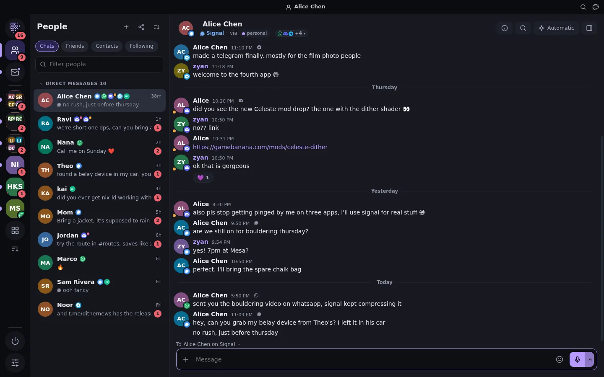

## Why it exists

- **Too many apps.** Most people have Discord for one group of friends, Signal for another, WhatsApp for family,
  and a work Matrix room. Each app has its own unread badge and its own notification settings, and each wants your
  attention. dither-chat puts them all in one list.
- **One person, one chat.** If a friend writes to you on Signal today and on Discord tomorrow, that is still one
  conversation. dither-chat merges their accounts into one person, with one page and one history.
- **Notifications that learn.** Every message lands in one of three tiers:
  - **Alert**: what can't wait.
  - **Conversation**: people talking with you.
  - **List**: everything else worth seeing.

  The app learns from what you open and what you answer. It also shows why it sorted each message the way it did.
- **Your data stays at home.** The hub (dither-chat's server, which keeps your messages) runs on a machine you own.
  Each network's own client runs there too, either in a sandbox or as a linked device, the way Signal or WhatsApp
  link a desktop app. There is no bridge server and no hosted service in the middle. The models that rank and sort
  run locally, so no message is ever sent to anyone else for that.
- **It's fast on a phone.** The app is an installable web app (PWA) with a small Android wrapper. It opens from a
  local snapshot in about a second. After hours away it fetches only what changed.

## What it looks like

### For you: the channel messages worth a look

The inbox keeps what needs you: DMs, small groups, replies you owe. **For you** is for the rest: single messages from
busy channels and big groups that you'd otherwise scroll past, ranked by how much they matter to you, with a burst of
messages folded into one. Looking at an item doesn't mark anything read. On a keyboard: `j`/`k` to move, `Enter` to
open, `x` to hide ([for you](docs/foryou.md)).

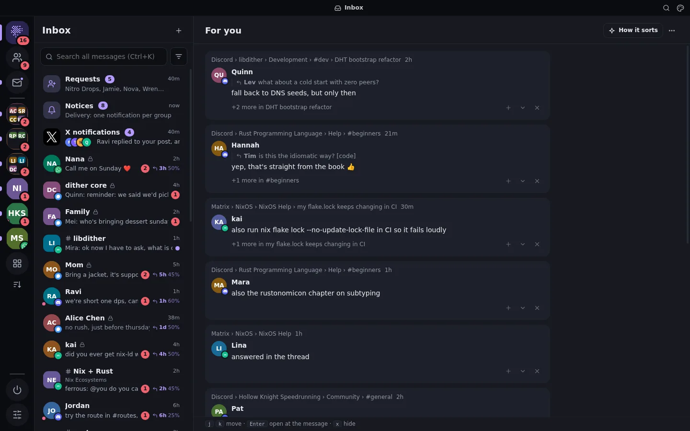

### How it sorts, in plain words

Every message gets a tier, and the app says why: a rule you set, a direct message, a chat where you usually answer.
You can look through this week's decisions and correct the wrong ones ([notifications](docs/notifications.md),
[inbox](docs/inbox.md)).

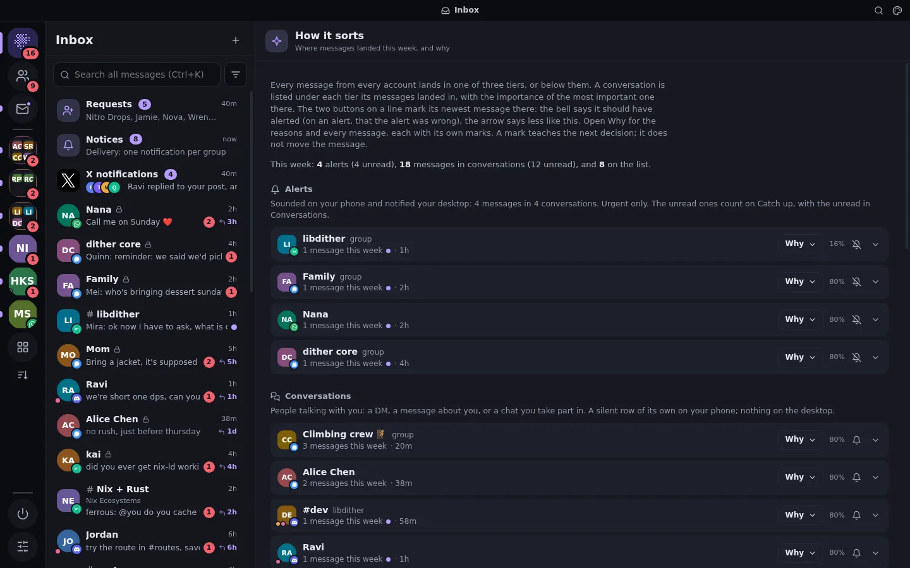

### Discord servers, Matrix spaces and WhatsApp communities

Servers keep their channels, categories, threads and forums. Bots work too, with their buttons, menus, slash commands
and forms ([apps](docs/apps.md), [threads](docs/threads.md), [servers](docs/servers.md)).

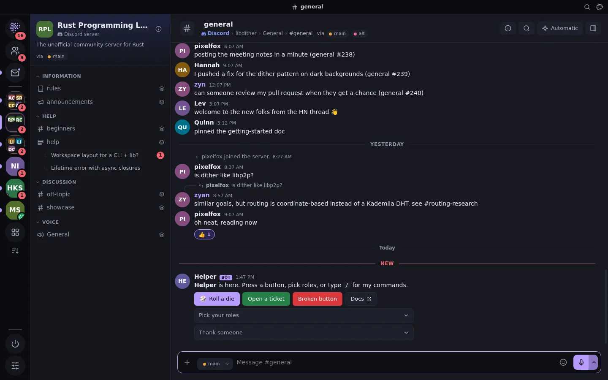

<table>
<tr>
<td width="50%">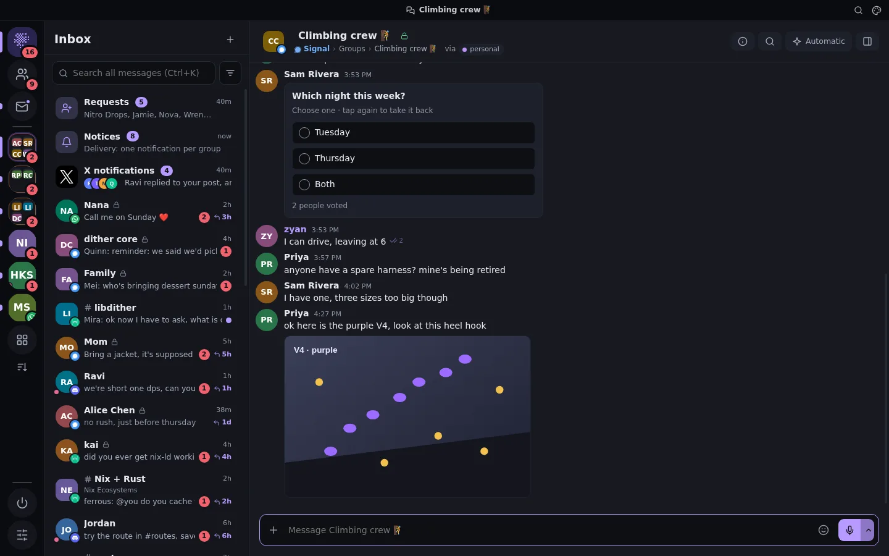</td>
<td width="50%">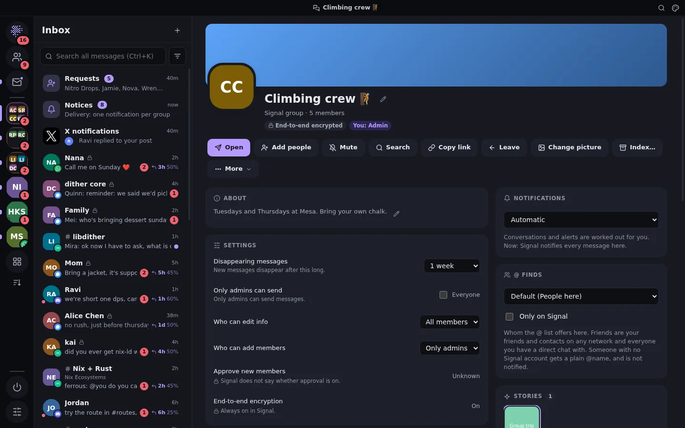</td>
</tr>
<tr>
<td>Polls, pictures, reactions, replies and edits look the same whichever network they came from.</td>
<td>One About page for every group, channel and server. You can change a setting wherever your account is allowed to.</td>
</tr>
</table>

### People, not accounts

A person's page lists every account they have, the servers and groups you share, and your recent messages with
them. The people graph shows who is in which servers and groups, across all your accounts
([profile](docs/profile.md), [people graph](docs/people-graph.md), [chats](docs/chats.md)).

<table>
<tr>
<td width="50%">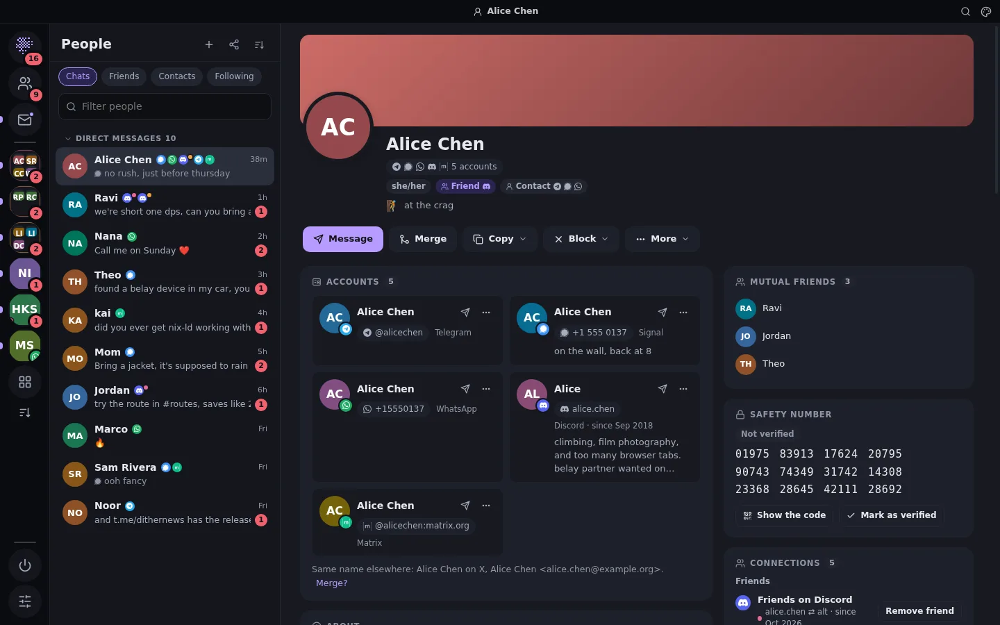</td>
<td width="50%">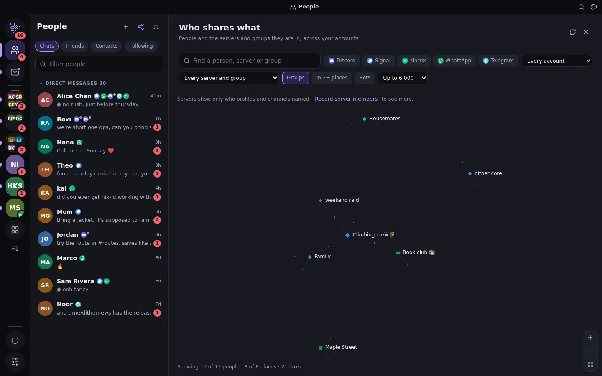</td>
</tr>
</table>

### Find anything

One search covers every network, with filters like Discord's. `Ctrl+K` opens a switcher that jumps to any person,
chat or server. It can also start a new message or group ([search](docs/search.md), [palette](docs/palette.md)).

<table>
<tr>
<td width="50%">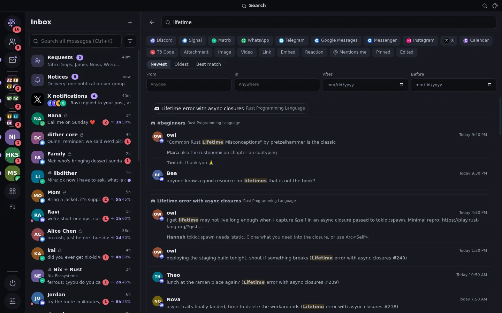</td>
<td width="50%">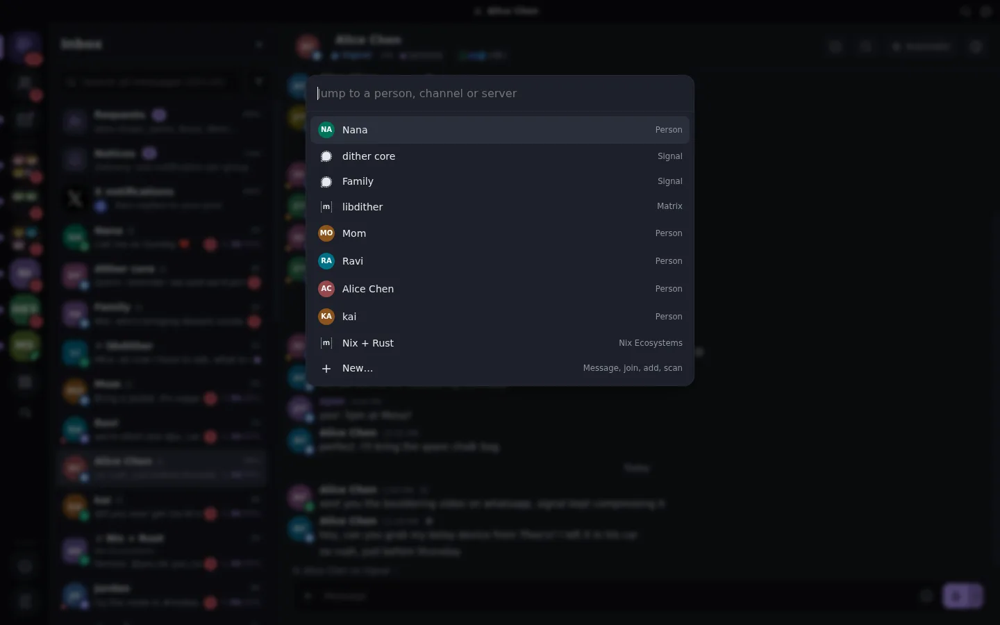</td>
</tr>
</table>

### Email and the X feed, beside your chats

Email from Gmail, Proton or any IMAP server shows up as threads that you can read, file and answer
([mail](docs/mail.md)). X's notifications (replies, mentions, likes and follows) arrive as a feed, and you can
answer from it ([feed](docs/feed.md)).

<table>
<tr>
<td width="50%">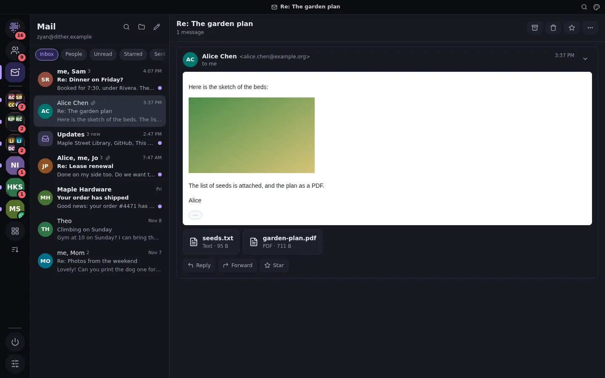</td>
<td width="50%">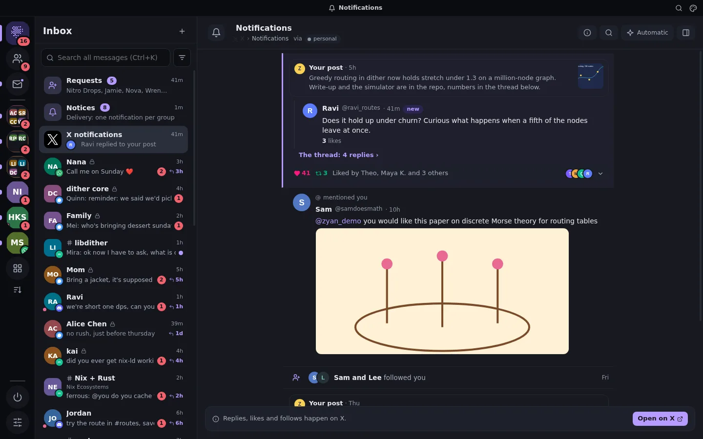</td>
</tr>
</table>

### On your phone

The same app, laid out like Discord's mobile app. Swipe between the list, the chat and its details. Swipe a message
to reply. Long-press for anything a mouse hover would give you ([phone](docs/phone.md), [Android](docs/android.md)).

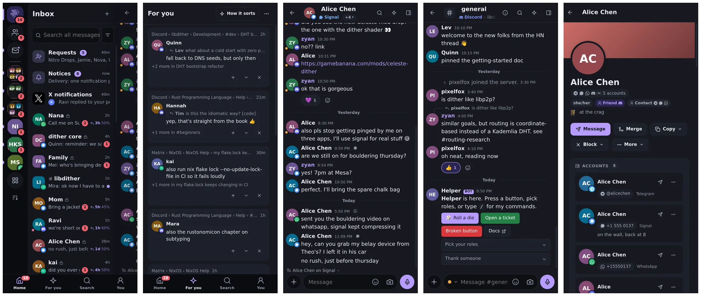

### And the rest

| | |
|---|---|
| **Calls** | Voice and video, with camera and screen sharing. Discord calls are the most complete. Other networks' calls go through the account's own client. The network normally sees your hub's address, not your phone's ([calls](docs/calls.md)) |
| **Notifications per device** | Each device has its own settings. For example: Signal off on the phone that already has the Signal app, and everything on the laptop. Quiet hours hold notifications back and send one summary when they end ([devices](docs/devices.md)) |
| **Reactions, stickers, voice messages** | Custom emoji, Discord super reactions, stickers, voice messages and view-once media ([reactions](docs/reactions.md), [media kinds](docs/media-kinds.md)) |
| **Files** | Text, code, Markdown, JSON, CSV, PDF and archives open in the app. A file's type is checked from its contents, not from what the network says. Uploads resume after a restart ([files](docs/files.md), [uploads](docs/uploads.md)) |
| **Sending options** | `@` mentions, replies that don't ping, silent messages, scheduled messages, forwarding to several chats at once ([mentions](docs/mentions.md), [sending](docs/sending.md), [menus](docs/menus.md)) |
| **Kept history** | The app can keep edits, deletions and disappearing messages. Each of the three is switched on or off per network ([history](docs/history.md)). Old history can be imported from Signal backups and Discord exports ([import](docs/import.md)) |
| **Moderation** | Remove or ban people, change roles and delete others' messages, wherever your account is allowed to ([moderation](docs/moderation.md)) |
| **Translation** | Posts in other languages are translated, either by the network itself or by a translation server you run ([translate](docs/translate.md)) |
| **Notices** | Things your services tell you, like a GitHub review request or an account that stopped, ranked with your chats ([notices](docs/notices.md)) |
| **Calendar** | Plans found in your chats, and reminders that arrive as messages ([calendar](docs/calendar.md)) |
| **Themes** | 16 themes, all checked for readable contrast. On desktop the app draws its own title bar ([desktop](docs/desktop.md)) |
| **Organizing** | Drag servers into folders that mix networks. Pin, hide, or sort by how much you use each place ([organize](docs/organize.md)) |

## How it works

```
 your accounts                            your machine                                your devices
 ─────────────                            ────────────                                ────────────
 Discord  ─┐                                                                      ┌─▶ phone (PWA / Android)
 Signal   ─┤      dither-accounts                      dither-chat hub            ├─▶ laptop (PWA)
 WhatsApp ─┼──▶  one sandboxed client  ──events──▶  stores, merges people,  ──────┼─▶ push (Web Push, ntfy)
 Matrix   ─┤     or linked device per  ◀─commands──  ranks and sorts, search      └─▶ other apps (calendar …)
 Telegram ─┤     account
 X, mail …─┘
```

Three parts, all on your own machine:

- **[dither-accounts](https://github.com/libdither/dither-accounts)** is a separate program that keeps your accounts
  signed in. For each account it runs either the network's own web client in a sandboxed browser, or a linked
  device like the one Signal or WhatsApp give a desktop app. You approve what dither-chat may do with each account.
  It is optional: dither-chat can also run the Discord, Signal, Matrix and WhatsApp clients itself
  ([accounts](docs/accounts.md)).
- **The hub** (`packages/hub`: Bun and SQLite) is the server. It receives each network's messages, removes
  duplicates, merges people across networks and decides each message's tier. It serves the app over HTTP and a live
  WebSocket.
- **The app** (`packages/web`: Preact) is one installable web app for phones and desktops. `apps/android` is a small
  Android wrapper that adds push, permissions and calls that keep going with the screen off.

Underneath, **`packages/protocol`** describes chats in a way that fits every network. Each conversation has three
properties: its shape (direct, group, channel, thread, notes to self), its kind (text, announcements, forum, voice…)
and which of your accounts can see it. People are kept separately from their accounts, so one person can have many.

## Try it

You need [Bun](https://bun.sh). These commands start a hub with a made-up demo world: an account on each network
and a few dozen chats. None of it is connected to a real network.

```sh
bun install
bun run web:build
bun run hub -- --demo --data "$(mktemp -d)"     # then open http://localhost:8460
```

For real accounts, run [dither-accounts](https://github.com/libdither/dither-accounts) next to the hub and add them
there ([docs/accounts.md](docs/accounts.md)). Or let the hub run them itself:

```sh
bun packages/hub/src/cli.ts add signal   --label personal   # then scan the QR code on its page
bun packages/hub/src/cli.ts add whatsapp --label personal   # QR code or pairing code
bun packages/hub/src/cli.ts add discord  --label main       # then sign in through the live view
bun packages/hub/src/cli.ts add matrix   --label main \
  --config '{"homeserver":"https://matrix.org"}' --secret '{"userId":"@you:matrix.org","password":"…"}'
```

The sandboxed clients need a few tools: signal-cli, Chromium, Xvfb, x11vnc, and a Matrix homeserver for tests.
`nix develop` gives you all of them.

**Phones and other computers.** Run one hub on a machine that is always on, and connect your devices to it over
[Tailscale](https://tailscale.com). Browsers only install a web app over HTTPS, so put Caddy in front of the hub
([docs/deploy.md](docs/deploy.md)).

**Who can read it.** The hub only answers your own machine and your tailnet (your private Tailscale network), and
past that only devices signed in with its password, or programs holding its service token. A demo world runs without
a login. A real hub (no `--demo`) stays shut until it has a password: set one, then sign in on each device as `admin`
([docs/login.md](docs/login.md)).

```sh
bun packages/hub/src/cli.ts set-password   # --data <dir> for a data dir other than the usual one
```

Account secrets live in the hub's data folder (`--data`), in `accounts/<id>/secret.json` (mode 0600), and never leave
the machine.

## Status

One person uses this as their everyday messenger, on a phone and a desktop, with real accounts on most of the
networks above. It's still young. Some newer features have only run against the demo world, a local Matrix server
or fake networks. Each doc says how far its feature has been tested. For what is missing, and why, see
[docs/ROADMAP.md](docs/ROADMAP.md).

## Working on it

```sh
bun run typecheck
bun run test          # every package's tests (scripts/test-all.ts)
bun run web:build
```

CI runs those three, plus checks for import cycles, unused files and bundle size ([docs/testing.md](docs/testing.md)).
Most features have a `scripts/verify-*.ts` script that drives the app in headless Chromium against a fresh demo hub.

Read [AGENTS.md](AGENTS.md) before opening a pull request. The main rule: nothing personal goes in the repo. No real
names, ids, message content or hostnames, whether in code, tests or commit messages.

## License

dither-chat is free software under the **GNU Affero General Public License, version 3 or later**
([LICENSE](LICENSE)): if you run a changed version for others over a network, offer them its source. Within it:

- The WhatsApp bridge (`packages/adapter-whatsapp/bridge`) links whatsmeow (MPL-2.0) and go.mau.fi/libsignal
  (GPL-3.0), so a built bridge binary is GPL-3.0, which the AGPL (section 13) lets it be combined with.
- `apps/android/gradle/wrapper/gradle-wrapper.jar` is Gradle's (Apache-2.0).
- Discord's libdave is not in this repository: `scripts/dave` fetches it from Discord's public assets on the machine
  that runs it ([scripts/dave/README.md](scripts/dave/README.md)).
- The networks' names and logos belong to their owners.
