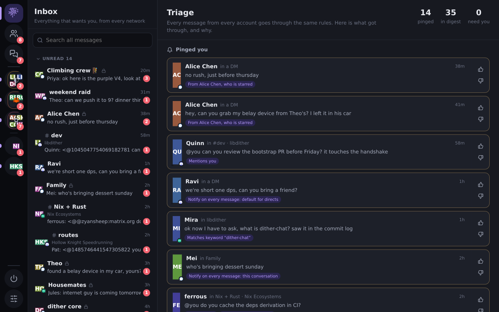

# dither-chat

One self-hosted hub that aggregates **Discord, Signal and Matrix** into a single
ontology — people, groups and communities — and serves every device as a PWA
over Tailscale. No bridge, no hosted middleman: the clients run on your own
machine and relay normalized facts to a local hub.



## Why

Replace Element desktop + two Discord accounts + Signal with one low-resource
app, with detailed (optionally AI-assisted) notification management, reachable
from every device. Everything runs on hardware you control.

## Architecture

```
adapter (1 per account) ──native-id facts over WS──▶ hub ──▶ PWA / MCP / ntfy
   discord | signal | matrix                    dedupe, store,
                                                 social graph, triage
```

- **`packages/protocol`** — the ontology and the adapter↔hub / hub↔client wire types.
- **`packages/hub`** — Bun + SQLite. Idempotent ingest, cross-account dedup,
  person-merge, notification triage, media proxy, live WebSocket, HTTP API,
  adapter supervisor. Entry: `packages/hub/src/main.ts`.
- **`packages/web`** — Preact PWA. Inbox triage board, per-person merged DM
  timelines, Discord/Matrix space trees with threads, folders, notification
  rules, sandbox live-view (noVNC), mobile layout.
- **`packages/adapter-{discord,signal,matrix}`** — one adapter per network.

The ontology has three independent axes — **Shape** (direct / group / channel /
thread / self), **Variant** (text / announcement / forum / voice / …) and
**Vantage** (which of your accounts sees it) — plus a graph (not tree) for
containment and a hub-only **Person** that merges identities across networks.
See `docs/DESIGN.md`.

## Run

```sh
nix develop            # bun, signal-cli, chromium, xvfb, x11vnc, a Matrix homeserver
bun install
bun run web:build
bun run hub -- --demo  # http://localhost:8460 with a seeded demo world
```

Browsers only install a PWA over HTTPS. To serve other devices that way, see [docs/deploy.md](docs/deploy.md).

Then add real accounts from the **Accounts** page, or with the CLI:

```sh
bun packages/hub/src/cli.ts add matrix --label main \
  --config '{"homeserver":"https://matrix.org"}' --secret '{"userId":"@you:matrix.org","password":"…"}'
bun packages/hub/src/cli.ts add signal  --label personal     # then scan the QR on its page
bun packages/hub/src/cli.ts add discord --label alt          # then sign in via the live view
```

Secrets live under `$DITHER_DATA/accounts/<id>/secret.json` (0600) and never
leave the hub. Run one hub on an always-on machine and use your phone and laptops as
clients over Tailscale (bind is `0.0.0.0`; the server only answers loopback + tailnet ranges).

## Status

| Piece | State |
|---|---|
| Hub, PWA, demo world | done |
| Matrix adapter | done — verified end-to-end against a local homeserver (E2EE rooms show as encrypted for now) |
| Signal adapter | done — QR device-link + messaging via signal-cli; a live link needs your phone |
| Reactions across networks | done: custom emoji, Discord super reactions, Signal's one-per-person, Matrix image packs ([docs/reactions.md](docs/reactions.md)). Sending a super reaction is untested for lack of Nitro |
| Installable PWA | done: HTTPS through Caddy with a Let's Encrypt wildcard, no per-device step ([docs/deploy.md](docs/deploy.md)), updates reach installed apps. Verified in headless Chromium, not yet on a phone |
| Arranging the sidebar | done: drag by mouse or touch, folders, pin, hide, stored on the hub |
| All communities | done: full-screen list with seven orderings, categories by yes/no question (keywords, or a local Ollama model) |
| Profiles | done: merged identities, shared places, recent messages. Bio and roles are not fetched, and starting a new DM needs an adapter command |
| Search | done: FTS5, filters, snippets, jump to message, Ctrl+K switcher. Searches what the hub has stored, not the network |
| Web Push | done: opt-in per device, verified through Google's relay. ntfy stays the self-hosted route |
| Edit and delete | done in hub and PWA; verified on the demo adapter only |
| Discord adapter (sandboxed real web client) | works on a live account: login through the live view, snapshot, history, send, reply, react. DMs and group DMs arrive live. Server channels do not: while the client sits idle, Discord pushes nothing for them, so they update when opened |

What is missing and why: [docs/ROADMAP.md](docs/ROADMAP.md).

## License

TBD.
