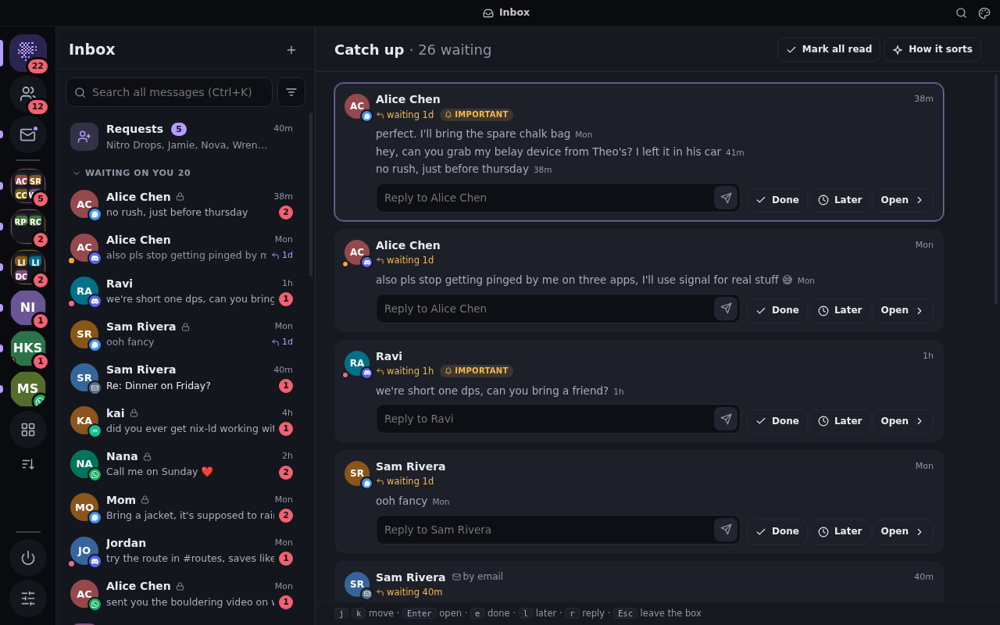

# dither-chat

One self-hosted hub that aggregates **Discord, Signal, Matrix and WhatsApp** into a single
ontology — people, groups and communities — and serves every device as a PWA
over Tailscale. No bridge, no hosted middleman: the clients run on your own
machine and relay normalized facts to a local hub.



## Why

Replace Element desktop + two Discord accounts + Signal with one low-resource
app, with detailed (optionally AI-assisted) notification management, reachable
from every device. Everything runs on hardware you control.

## Architecture

```
adapter (1 per account) ──native-id facts over WS──▶ hub ──▶ PWA / MCP / ntfy
   discord | signal | matrix | whatsapp         dedupe, store,
                                                 social graph, triage
```

- **`packages/protocol`** — the ontology and the adapter↔hub / hub↔client wire types.
- **`packages/hub`** — Bun + SQLite. Idempotent ingest, cross-account dedup,
  person-merge, notification triage, media proxy, live WebSocket, HTTP API,
  adapter supervisor. Entry: `packages/hub/src/main.ts`.
- **`packages/web`** — Preact PWA. One ranked inbox, Catch up, per-person merged DM
  timelines, Discord/Matrix space trees with threads, folders, notification
  rules, sandbox live-view (noVNC), and a phone layout with Discord's panels and gestures.
- **`packages/adapter-{discord,signal,matrix,whatsapp}`** — one adapter per network.

The ontology has three independent axes — **Shape** (direct / group / channel /
thread / self), **Variant** (text / announcement / forum / voice / …) and
**Vantage** (which of your accounts sees it) — plus a graph (not tree) for
containment and a hub-only **Person** that merges identities across networks.
See `docs/DESIGN.md`.

## Run

```sh
nix develop            # bun, signal-cli, chromium, xvfb, x11vnc, a Matrix homeserver
bun install
bun run web:build
bun run hub -- --demo  # http://localhost:8460 with a seeded demo world
```

Browsers only install a PWA over HTTPS. To serve other devices that way, see [docs/deploy.md](docs/deploy.md).

Then add real accounts from the **Accounts** page, or with the CLI:

```sh
bun packages/hub/src/cli.ts add matrix --label main \
  --config '{"homeserver":"https://matrix.org"}' --secret '{"userId":"@you:matrix.org","password":"…"}'
bun packages/hub/src/cli.ts add signal  --label personal     # then scan the QR on its page
bun packages/hub/src/cli.ts add whatsapp --label personal    # then scan the QR, or ask for a pairing code
bun packages/hub/src/cli.ts add discord --label alt          # then sign in via the live view
```

Secrets live under `$DITHER_DATA/accounts/<id>/secret.json` (0600) and never
leave the hub. Run one hub on an always-on machine and use your phone and laptops as
clients over Tailscale (bind is `0.0.0.0`; the server only answers loopback + tailnet ranges).

## Status

| Piece | State |
|---|---|
| Hub, PWA, demo world | done |
| Matrix adapter | done — verified end-to-end against a local homeserver |
| Matrix end-to-end encryption | done, opt-in per account: read, write, media, old messages through the key backup, emoji verification. Verified on a local homeserver only, never with Element or on matrix.org ([details](packages/adapter-matrix/README.md#end-to-end-encryption)) |
| Signal adapter | done — QR device-link + messaging via signal-cli; a live link needs your phone |
| WhatsApp adapter | built, not yet linked to a real account: a linked device through whatsmeow, the library Beeper uses (why not the web client in a sandbox: [docs/whatsapp.md](docs/whatsapp.md)). QR or pairing-code linking, history sync, DMs, groups, communities as spaces, media, reactions, replies, edits, deletes, read state, native forwards. Verified against fixtures, a fake bridge, and the real bridge up to a fresh link code |
| Reactions across networks | done: custom emoji, Discord super reactions, Signal's one-per-person, Matrix image packs ([docs/reactions.md](docs/reactions.md)). Sending a super reaction is untested for lack of Nitro |
| Installable PWA | done: HTTPS through Caddy with a Let's Encrypt wildcard, no per-device step ([docs/deploy.md](docs/deploy.md)), updates reach installed apps. Verified in headless Chromium, not yet on a phone |
| On a phone | done: the same app, laid out like Discord's: swipe between the lists, the page and its details, swipe to reply, long-press for everything a hover offers, sheets that drag away, back that closes them first, an image viewer, the keyboard and the notch handled. Everything the desktop does is reachable ([docs/phone.md](docs/phone.md)). Verified with touch input in headless Chromium, not yet on a real phone |
| Themes and the title bar | done: 16 themes (Dither, Discord, AMOLED, Nord, Dracula, Catppuccin, Gruvbox, Rosé Pine, Tokyo Night, Solarized, high contrast), all checked at WCAG AA by a test, with live preview and a follow-the-system pair; the installed app can draw its own title bar (window controls overlay) ([docs/desktop.md](docs/desktop.md)). The overlay is untested in a real installed window |
| One ranked inbox | done: DMs, group chats, rooms outside a space and notes to self in one list with filter chips, ranked on the hub by how much each needs you (an unanswered message weighted by how often you answer that person, how much you talk there, noise against engagement) and where you were just now, then reordered by a model learned on the hub from what you open (beat the formula on held-out days of a real hub's activity log), with the reasons on hover; Ctrl+K ranks by the same score ([docs/inbox.md](docs/inbox.md)). Metadata only, never message text. Verified on the demo world and the score distribution on a copy of a real hub |
| Arranging the sidebar | done: drag by mouse or touch, folders, pin, hide, stored on the hub |
| All communities | done: full-screen list with seven orderings, categories by yes/no question (keywords, or a local Ollama model) |
| Profiles | done: merged identities, shared places, recent messages. Bio and roles are not fetched, and starting a new DM needs an adapter command |
| Search | done: FTS5, filters, snippets, jump to message, Ctrl+K switcher. Searches what the hub has stored, not the network |
| Web Push | done: opt-in per device, verified through Google's and Mozilla's relays and, for the Android app, through ntfy (ntfy.sh or your own server, allowed from the app) |
| Android app | done: a 250 KB WebView shell with native permissions, calls that survive the screen going off, and push through UnifiedPush ([docs/android.md](docs/android.md)). The web app now starts from a local snapshot and a cached shell: about 1 s to content instead of 4.5 s on a big hub. Verified on the emulator, not yet on a phone |
| Coming back to the app | done: a reconnect asks the hub only for what changed since (a change journal; about a kilobyte when little did, 60-140 KB after hours away, against 800 KB before), with no banner for short drops and sends that wait for the hub, kept on the device across a reload ([docs/sync.md](docs/sync.md)). Verified in headless Chromium and against a copy of a real database, not yet on a phone |
| Speed on a big hub | measured: `scripts/verify-perf.ts` times load, chat switching, long timelines and arriving messages on a demo hub grown to the live hub's size, against a committed baseline ([docs/perf.md](docs/perf.md)). A long timeline reopens in 0.5 s instead of 7 s, and an arriving message costs 0.2 s of main thread instead of 11 s. Measured in headless Chromium; CI has no browser |
| Edit and delete | done in hub and PWA; verified on the demo adapter only |
| Right-click menus and forwarding | done: Discord's menus on messages, channels, servers, folders, people, accounts, files and links, as sheets on a phone; forwarding to several places at once, natively on Discord (verified on the throwaway account) and as a copy across networks ([docs/menus.md](docs/menus.md)) |
| About and settings | done: one panel for every group, channel, server, room, space and community: name, description, members with their roles, who may change what, invite link, disappearing messages, slow mode, age flag, announcement-only, join rules and pins, each editable only where your account may, with the network's reason where it may not ([docs/group-settings.md](docs/group-settings.md)). Verified on the demo world, Matrix also on a local homeserver; Discord, Signal and WhatsApp changes are untested on a live account |
| Typing indicators | done: both ways on every network, shown as Discord shows them, never stored, with a privacy switch ([docs/typing.md](docs/typing.md)). Discord's sending verified live on the throwaway account, Matrix both ways on a local homeserver; Signal and WhatsApp against fixtures. WhatsApp mostly does not deliver others' typing, because the adapter never marks you online |
| Notifications per device | done: each device leaves out what the shared rules let through, per network, account, community or chat (Signal off on the phone, which has the Signal app; everything on the laptop), without touching the inbox. Notifications show the sender's picture with the network's badge, and the network's mark as the small icon ([docs/devices.md](docs/devices.md)). Verified in headless Chromium and on the emulator, not yet on a phone |
| Mark all read | done: everywhere, or per server, folder or person, through a paced queue on the hub. Verified on the demo adapter only |
| Quiet hours | done: a daily schedule that holds pushes, with one summary when it ends. Verified on the demo adapter only |
| Sending files | done: paste, drop or pick, with progress; uploads resume and survive a hub restart ([docs/uploads.md](docs/uploads.md)). Live on Discord, on a local homeserver for Matrix (encrypted rooms too, once encryption is set up), not yet live on Signal |
| Files | done: a file's card says what it really is (by its bytes, not the network's label) with pages, lines or entries; text and code, Markdown, JSON, CSV, PDF and archives open in viewers in the app, and other types in your own apps ([docs/files.md](docs/files.md)). Verified on the demo world in headless Chromium |
| Email | slice 1 built: Inbox and Sent of any IMAP or Proton account in dither-accounts, kept up through its events, threaded by Message-ID, read as text with quotes folded, read state kept on the hub, on a phone and a desktop ([docs/mail.md](docs/mail.md), design in [docs/mail-design.md](docs/mail-design.md)). Verified against dither-accounts' Dovecot and a fake server; no real mailbox yet. HTML, filing, sending, search and mail in the inbox are the next slices |
| Accounts in dither-accounts | built: the adapters moved to [dither-accounts](../dither-accounts), whose manager can run any account for this hub while the hub runs the rest, one account at a time, with a lock so none runs twice and a one-line rollback ([docs/accounts.md](docs/accounts.md)). Verified with the Matrix testbed and a fake chat account, not yet on a live account |
| Discord adapter (sandboxed real web client) | works on a live account: login through the live view, snapshot, history, send, reply, react. DMs and group DMs arrive live. Server channels do not: while the client sits idle, Discord pushes nothing for them, so they update when opened |

What is missing and why: [docs/ROADMAP.md](docs/ROADMAP.md).

## License

dither-chat is free software under the **GNU Affero General Public License, version 3 or later**
([LICENSE](LICENSE)): if you run a changed version for others over a network, offer them its source. Within it:

- The WhatsApp bridge (`packages/adapter-whatsapp/bridge`) links whatsmeow (MPL-2.0) and go.mau.fi/libsignal
  (GPL-3.0), so a built bridge binary is GPL-3.0, which the AGPL (section 13) lets it be combined with.
- `apps/android/gradle/wrapper/gradle-wrapper.jar` is Gradle's (Apache-2.0).
- Discord's libdave is not in this repository: `scripts/dave` fetches it from Discord's public assets on the machine
  that runs it ([scripts/dave/README.md](scripts/dave/README.md)).
- The networks' names and logos belong to their owners.
