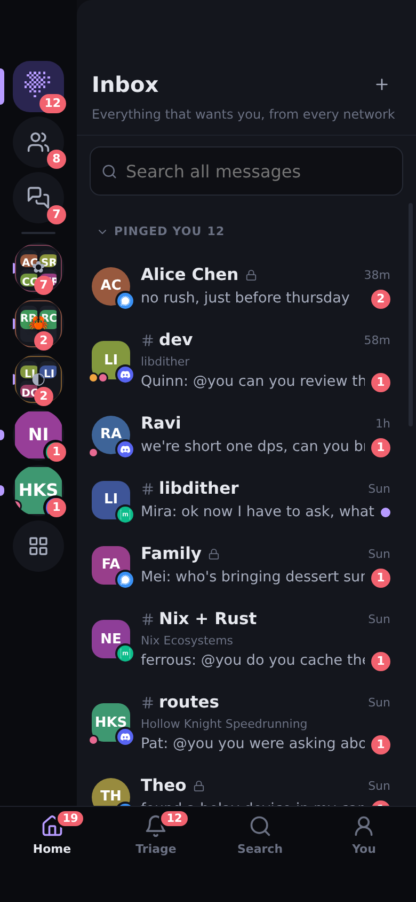

# dither-chat on a phone

The phone app is the installed PWA: the same Preact components as on a desktop, laid out differently below
820px wide. There is no native wrapper and nothing here needed one.



## How it is laid out

Discord's app is the model. The rail (Inbox, People, then your servers, spaces and folders) and the
list beside it sit underneath. The page you open, a conversation, a profile, an account, is a card that
slides in over them. A tab bar along the bottom shows whenever the lists do:

| Tab | What it is |
|---|---|
| Home | The rail and the list you were last on |
| Triage | The board: what pinged you and why, the digest, accounts that need you, Mark all read |
| Search | Search with every filter; a search for a name also lists matching people, communities and channels |
| You | Settings, with your accounts first and Add account |

The card and the panels are moved by `src/ui/Pager.ts`; `src/gesture.ts` holds the arithmetic (axis lock,
release velocity, when a swipe commits, rubber banding) and is unit tested. `src/phone.ts` has the layers the
back button closes, the keyboard handling and the sheet drag. Wider than 820px nothing of this applies, and
the desktop is unchanged apart from the fixes listed below.

## Gestures

| Gesture | Where | What it does |
|---|---|---|
| Swipe right | Any page, from the edge or anywhere | Back. The page follows the finger and settles beside its list with its edge showing, as in Discord |
| Swipe left, or tap the edge | A page left peeking beside the list | Brings it back |
| Swipe left | A page with details (conversation, person) | The details panel: source, accounts, notifications, members, threads |
| Swipe right, tap the page, or back | The details panel | Closes it |
| Swipe a message left | Conversation | Reply to it. A tick when it crosses the line |
| Long-press | A message | Its action sheet (below) |
| Long-press | A reaction | Who reacted |
| Long-press, or hold and drag | A rail entry, a row, a card in All communities | The arrange sheet; or drag to reorder and make folders |
| Drag down | A sheet's grabber or header; anywhere in it once scrolled to its top | Dismisses it. A short drag springs back |
| Pull down | The top of a list or the Triage board | Reloads everything from the hub, or reconnects |
| Pinch, double-tap, drag | An image | Zoom and pan, up to 5x |
| Swipe sideways, swipe down | An image | Next or previous image of the message; close |
| Flick sideways or up | A toast | Dismisses it |

Every motion is a transform that follows the finger, and the release decides by distance and by speed: a
quick flick commits, a slow short drag springs back, and the rest of the way takes as long as the finger's
speed implies. With `prefers-reduced-motion` the panels and sheets still follow the finger, but settle at once
and open without animating. `navigator.vibrate` ticks on a long-press, on a reply swipe crossing its line and
on a pull crossing its line, and nowhere else.

**Back.** Every sheet, menu, dialog, viewer and the details panel is a layer with a history entry of its own,
so Android's back button (or `history.back()`) closes the top one before it leaves the page. Navigating from
inside one takes over its entry instead of stacking a new one. Back buttons in the app go back through
history where there is some, and to the page's list where there is none (a page opened from a link or a
notification). Installed iOS apps have no back gesture of their own; the swipe right is it.

**Keyboard.** The viewport asks Chromium to resize the layout for the keyboard
(`interactive-widget=resizes-content`). Where only the visual viewport shrinks (iOS Safari), the app is
sized and moved to it while a field has focus, so the composer sits just above the keyboard. Fields are 16px
so iOS does not zoom into them. The notch and the home indicator are kept clear with the safe-area insets;
while the keyboard is up the bottom inset is dropped and the tab bar steps aside. On a touch keyboard Enter makes a new line (there
is no Shift+Enter) and the send button sends; Ctrl+Enter also sends.

## Parity: everything the desktop does, on a 390x844 touch screen

"Before" is the phone layout as it was before this work: five tabs (Inbox, People, Groups, Spaces, More),
no rail, hover actions hidden, a long-press sheet with reactions, reply, copy, edit and delete.

| Desktop capability | How on a desktop | Before, on a phone | Now, on a phone |
|---|---|---|---|
| Inbox: one ranked list of DMs, groups, rooms outside a space and notes ([inbox.md](inbox.md)) | Sidebar | Inbox tab | Home, Inbox in the rail |
| Triage board: Important, Active, Digest and Not interesting, each with ▲/▼ votes, and the counts | Center pane with nothing open | **Unreachable**: the inbox tab showed the list | Triage tab |
| Mark all read, everywhere | Board button | **Unreachable** | Triage tab; per place in its arrange sheet |
| People, merged DM timeline, one network's chat | Rail, sidebar, header chips | People tab; chips wrapped | Rail; the chips scroll sideways, and the details panel lists each chat |
| Group chats (now in the inbox), spaces with channel trees and threads, folders | Rail and sidebar | Groups and Spaces tabs, no rail | The inbox, and the rail and its list, as in Discord |
| Open a folder in the rail; open it as a list | Click; arrange menu | Spaces tab | Tap in the rail; arrange sheet |
| Arrange: drag to reorder, folders, pin, hide, move up/down, rename, delete folder, add a group to the sidebar | Drag; right-click menu | Hold and drag; popup menu sized for a mouse | Hold and drag; the menu is a bottom sheet |
| All communities: seven orderings, network filter, hidden places, manual order by drag | Rail grid button | Spaces tab | Rail grid button; chip rows scroll sideways |
| Categories: edit the questions, per-place yes/no/auto | Dialogs | Centered dialogs | Bottom sheets |
| Per-place notification level, whole server | Header menu | Small dropdown | Bottom sheet |
| Per-place overrides list, clear one | Settings | More tab | You tab |
| Conversation header: where it is, via which account, search in it, profile, all chats, details | Header | Wrapped to four lines | One line that fades; "via" is in the details panel; Profile and All chats in the details panel |
| Details panel: source, accounts, native id, open in the network's app, level, members, threads | Toggle in the header | Full-screen overlay | Swipe left, or the header button; a panel with the page peeking |
| Person details: identities, split, merge, star, chats | Details panel | Full-screen overlay | Panel |
| Profile and the merge flow | Avatar, member or mention | Reachable | Reachable; swipe back |
| New message (start a DM), send-as account | Plus in the Inbox and People headers; dialog | Centered dialog | Plus in the headers; bottom sheet |
| Quick switcher | Ctrl+K | **Keyboard only** | Search tab: searching a name lists people, communities and channels to jump to |
| Search with filters, scope to one conversation, jump to a message | Sidebar box, header button | Reachable | Search tab; searching a conversation is a page with a way back to it |
| Hover bar on a message: three reactions, picker, edit, delete, reply | Hover | Long-press: reactions, reply, copy, edit, delete | Long-press: also the author's profile, the thread, the message it replies to |
| Exact time of a grouped message | Hover | **Hidden** | Sheet header |
| Which account a message came through, its encryption warning, the author's handle | Tooltips | **Hidden** | Sheet header; profile |
| Why a message pinged or not, and feedback | Pill, visible on hover except for pings | **Invisible pill** for silent and digest | Sheet: reasons and both buttons |
| Who reacted | Right-click a pill | Long-press | Long-press, as a sheet |
| Reaction picker, skin tone, super reactions, search | Popover | Sheet without drag | Sheet that drags away |
| Reply, edit, cancel either | Hover bar; Escape | Sheet; X | Swipe or sheet; X |
| New line in a message | Shift+Enter | **None**: Enter always sent | Enter |
| Attach files: pick, paste, drop | Button, paste, drop | Button, paste | Button, paste (dropping files is desktop only) |
| Images | Opened a new tab | Left the installed app | Viewer: zoom, pan, page, swipe down; "Open the original" |
| Threads, forums, voice text chat, jump to latest, older history | Click; scroll | Reachable | Reachable; older history loads as you scroll, with a skeleton |
| Accounts: status, add, restart, disable, log, remove | Rail button | **Unreachable** except through a "needs you" row | You tab: accounts first, Add account |
| Account live view with paste, fit or actual size | Account page | Reachable only when it needed you | Reachable; back closes it |
| Signal link code, full screen | Account page | As above | Reachable; back closes it |
| Matrix encryption setup, recovery key, emoji verification | Account page | As above | Reachable. Not in the demo, so checked in the code only |
| Default levels, per network, smart triage, notifications while open | Settings | More tab | You tab; the section list on a desktop now scrolls to each section |
| Web Push opt-in, devices | Settings | More tab | You tab |
| Quiet hours, daily digest | Settings | More tab | You tab; time fields at 16px |
| Keywords that are always Important | Settings | More tab | You tab |
| Theme, demo accounts, reset demo | Settings | More tab | You tab |
| Toasts, open the conversation from one | Bottom right | Covered the composer | At the top; tap to open, flick to dismiss |
| Unread and mention badges | Rail | None on the tabs | Rail, and the Home and Triage tabs; You has a dot when an account needs you |
| Collapse sections and categories | Click | Tap, under 44px | Tap, 40-44px |
| Escape closes things | Keyboard | Nothing | Back button, swipes, tap outside |

Also fixed on the way, on every screen size: a message held for the digest had an empty line under its
author (the pill borrowed the digest card's padding), and the settings list on the left did nothing.

**Left as they are.** Folder names and confirmations use the browser's own `prompt` and `confirm`, which
phones show as system dialogs: they work, but are not styled like the rest. Dropping files onto the composer
has no phone equivalent beyond the attach button and paste. A phone held sideways is wider than 820px and
gets the desktop layout, with finger-sized targets. The live view of a sandboxed client works on a phone,
but solving a captcha on a phone-sized copy of a desktop browser is fiddly. The old Spaces tab is gone; the
rail does its job, and hidden places are under Hidden in All communities.

## Checked how

`bun scripts/verify-phone.ts <demo hub url> [screenshot dir]` drives a private headless Chromium emulating a
390x844 phone (mobile metrics, touch emulation, a 47px notch and a 34px home indicator) with real touch input
through `Input.dispatchTouchEvent`. Run it against a fresh demo hub:

```sh
bun run web:build
bun packages/hub/src/main.ts --demo --data "$(mktemp -d)" --port 8470 --host 127.0.0.1 --web packages/web/dist
bun scripts/verify-phone.ts http://127.0.0.1:8470 docs/screenshots
```

It swipes the card back and forward and checks it follows the finger mid-swipe, that a short slow swipe
springs back and a short fast flick commits; opens and closes the details panel by swipe, button and back;
swipes a message to reply; long-presses for the sheet, checks what it carries, and that sliding the finger
on afterwards does not drag the page under it; long-presses a reaction for who reacted; drags sheets and dialogs
away and lets a short drag spring back; walks the back button through a sheet, then out of the conversation,
then forward; pinches, double-taps and swipes away the image viewer; swipes back from a profile, an account
and a scoped search; shrinks the layout (Android) and the visual viewport (iOS) under a focused composer;
pulls a list to refresh and waits for the hub; flicks a toast; and on every main screen, scrolled top to
bottom, checks nothing scrolls sideways or runs off the right edge; and that touch targets in the tab bar,
rail, lists, conversation header, composer and settings are 40px or more.

**What headless cannot show.** It is Chromium on Linux pretending: not iOS Safari, which handles the
keyboard, the visual viewport, `100%` heights and installed apps in its own way, and was only imitated here by
faking the visual viewport. No real keyboard was opened; its effect was imitated by resizing. Frame rate on a
real phone is unknown: the motion is transforms only and every finger move is one style write, but whether it
holds 60fps on a mid-range phone with a long timeline has not been measured. Haptics, safe areas on real
hardware, the Android back button itself (as opposed to `history.back()`) and Web Push are untested on a
phone. ROADMAP's "Try it on a real phone" still stands.

## Screenshots

From the demo hub, at 390x844:
[home](screenshots/36-phone-home.png),
[conversation](screenshots/37-phone-conversation.png),
[mid swipe back](screenshots/38-phone-swipe-back.png),
[page peeking beside the list](screenshots/39-phone-peek.png),
[details panel](screenshots/40-phone-details.png),
[swipe to reply](screenshots/41-phone-swipe-reply.png),
[message sheet](screenshots/42-phone-message-sheet.png),
[image viewer](screenshots/43-phone-image-viewer.png),
[Triage tab](screenshots/44-phone-triage.png),
[You tab](screenshots/45-phone-you.png),
[account](screenshots/46-phone-account.png),
[a menu as a sheet](screenshots/47-phone-menu-sheet.png),
[arrange sheet](screenshots/48-phone-place-menu.png),
[All communities](screenshots/49-phone-directory.png),
[keyboard up](screenshots/50-phone-keyboard.png),
[search](screenshots/51-phone-search.png),
[profile](screenshots/52-phone-profile.png),
[pull to refresh](screenshots/53-phone-pull-to-refresh.png),
[a dialog as a sheet](screenshots/54-phone-dialog-sheet.png),
[light theme](screenshots/55-phone-light.png).
